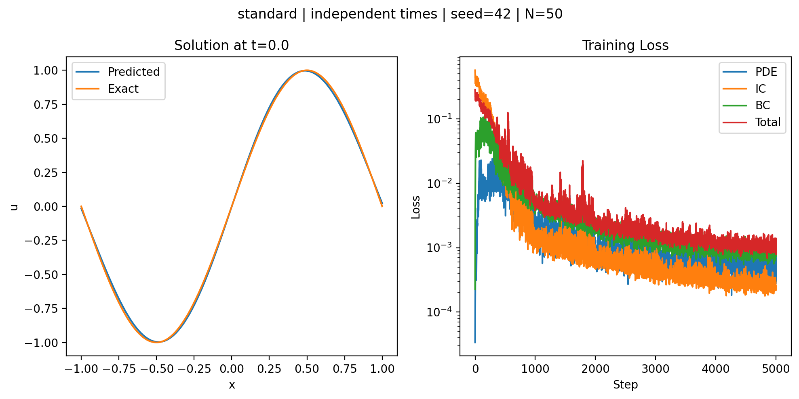

# 一维热传导 PINN：标准方法与混合求导复现

**当前状态：基础复现完成，精度优化待续。** 本项目记录从自动求导练习到标准 PINN、混合 PINN 及时间采样控制实验的学习过程。已保存模型、损失曲线和评估结果，可以不重新训练直接核查。

标准方法的最佳已记录整体相对 L2 为 **6.20%**，初始条件及左右边界的最大误差均低于 **0.05**；整体相对 L2≤5% 的学习目标尚未达到。

## 求解问题

$$
\frac{\partial u}{\partial t}=\alpha\frac{\partial^2u}{\partial x^2},\qquad x\in[-1,1],\quad t\in[0,1],\quad \alpha=1.
$$

$$
u(x,0)=\sin(\pi x),\qquad u(-1,t)=u(1,t)=0.
$$

用于独立评估的解析解：

$$
u(x,t)=e^{-\alpha\pi^2t}\sin(\pi x).
$$

标准 PINN 对时间和空间都使用自动求导；混合 PINN 对时间使用自动求导，对空间使用三点二阶差分。混合方法中，每组空间网格必须共享同一时间，矩阵只输出内部点导数，端点由边界损失约束。网络输入顺序为 `[t, x]`。

## 环境与快速验证

记录环境：Windows、Python 3.10.10、PyTorch 2.14.1+cu126、NumPy 1.23.5、Matplotlib 3.7.2。**本仓库所列训练均在 CPU、float32 下运行**，不要求 GPU。

已有 `pinn-heat-lab` 环境时直接激活，无需重建。首次配置可在项目根目录执行：

```powershell
conda env create -f environment.yml
conda activate pinn-heat-lab
python -m pip install torch==2.14.1 --index-url https://download.pytorch.org/whl/cpu
python -m pip install -r requirements.txt
```

需要 NVIDIA CUDA 12.6 版本时，将上述 PyTorch 安装命令替换为：

```powershell
python -m pip install torch==2.14.1 --index-url https://download.pytorch.org/whl/cu126
```

`environment.yml` 创建 Python 与 pip 环境，`requirements.txt` 固定直接依赖。版本取自实际运行环境；本次发布没有在全新环境中验证安装，也没有锁定所有间接依赖。安装 GPU 包不会让现有 CPU 脚本自动使用 GPU。

激活环境后，在项目根目录逐条执行：

```powershell
python check_env.py
python check_pde.py
python check_spatial.py
python check_hybrid.py
python evaluate_saved.py
```

检查内容分别为解释器与 PyTorch、解析解的 PDE 残差、N=50/100/200 的空间差分、共享时间的混合残差，以及四组已保存实验。`check_spatial.py` 和 `check_hybrid.py` 主要打印数值供检查；混合离散残差含截断误差，不要求等于机器零。

`evaluate_saved.py` 验证模型权重与损失历史，并在 **201 个空间点 × 101 个时间点** 上重新计算 MAE、整体相对 L2、初始条件最大误差和两端边界最大误差。成功时输出 `PASS: 4 saved runs verified; no training performed.`。它不会重新训练或覆盖文件。

也可以只验证一组：

```powershell
python evaluate_saved.py --run standard_independent
```

## 已记录结果

所有下列实验采用 6 个隐藏层、每层 50 个神经元、Tanh、种子 42、5000 步。损失为 `PDE + 0.5*IC + 0.5*BC`，其中 BC 为左右两端 MSE 之和；Adam 初始学习率 0.001，每 1000 步乘 0.5。初始条件每步采样 100 点，左右边界共用 100 个时间值。

| 实验 | PDE 采样 | MAE | 相对 L2 | IC 最大误差 | 左 / 右 BC 最大误差 | 训练耗时 |
| --- | --- | --- | --- | --- | --- | --- |
| 历史标准基线 | 100 个独立时空点 | 0.008559 | 6.9144% | 0.04613 | 0.04193 / 0.06004 | 未记录 |
| 标准 PINN 分组对照 | 4 个时间 × 50 个空间点 | 0.013933 | 11.2374% | 0.04880 | 0.08786 / 0.07835 | 42.28 秒 |
| 混合 PINN 分组对照 | 同上 | 0.013683 | 11.0320% | 0.05087 | 0.08791 / 0.07315 | 26.10 秒* |
| 标准 PINN 时间采样实验 | 同样的空间点，每点独立时间 | 0.007603 | **6.2038%** | 0.02810 | 0.04955 / 0.04358 | 48.48 秒 |

分组实验和时间采样实验每步均有 192 个内部残差点。整体相对 L2 定义为 `sqrt(sum((prediction-exact)^2) / sum(exact^2))`，表中转换为百分比；训练损失与该解误差是不同指标。

*混合耗时由用户终端截图转录，其余已记录耗时来自原始 JSON。两种求导方法的分组对照精度接近，混合方法在这一次运行中耗时较少。计时含训练日志与检查开销，两份脚本开销略有差别，未控制机器负载，不能据此宣称普遍的速度或精度优势。*

时间采样实验固定网络初始化、空间位置、残差数量、初边值样本、优化器与步数，仅改变 PDE 时间抽样方案，将标准方法相对 L2 从 11.24% 降到 6.20%。这支持本配置对时间覆盖敏感；仍需更多种子验证。逐点独立时间不能直接用于混合方法的空间差分。



图左仅展示初始时刻，全时空精度以表中指标为准。详细过程见 [完整实验记录](docs/EXPERIMENTS.md)，文件对应关系和计时来源见 [结果目录说明](outputs/README.md) 与 [结果汇总 JSON](outputs/results.json)。

## 重新运行实验

训练脚本保留学习阶段的独立结构，参数在各文件顶部。默认运行会写入对应的 `outputs/` 文件；希望保留发布基线时，建议使用新的输出目录：

```powershell
python -c "import train_compare_demo2 as run; run.method='standard'; run.main(output_dir='outputs/local_runs/standard', show_plot=False)"
python -c "import train_compare_demo2 as run; run.method='hybrid'; run.main(output_dir='outputs/local_runs/hybrid', show_plot=False)"
python -c "import train_sampling_demo3 as run; run.main(output_dir='outputs/local_runs/independent', show_plot=False)"
```

前两条在共同的分组网格上比较求导方法；第三条默认运行标准 PINN 的独立时间实验。新运行的数值和耗时可能随平台与依赖发生变化；新的实验输出不会自动进入发布结果汇总。

| 文件 | 用途 |
| --- | --- |
| [problem.py](problem.py) | 解析解及物理参数传递 |
| [check_autograd.py](check_autograd.py)、[check_pde.py](check_pde.py) | 自动求导练习、解析解残差检查 |
| [check_spatial.py](check_spatial.py)、[check_hybrid.py](check_hybrid.py) | 空间差分、分组混合残差检查 |
| [train_compare_demo2.py](train_compare_demo2.py) | 标准与混合 PINN 的共同训练入口 |
| [train_sampling_demo3.py](train_sampling_demo3.py) | 标准 PINN 的时间采样控制实验 |
| [evaluate_saved.py](evaluate_saved.py) | 无需训练，复核四组已保存结果 |
| [train_pinn_demo2.py](train_pinn_demo2.py)、[train_pinn_demo3.py](train_pinn_demo3.py)、[train_hybrid_demo.py](train_hybrid_demo.py) | 保留早期学习阶段及历史基线 |
| [plot_exact.py](plot_exact.py)、[plot_history.py](plot_history.py) | 解析解与历史损失绘图 |

## 参考与范围

参考项目：[yydjya/PINN-solves-the-one-dimensional-heat-conduction-equation](https://github.com/yydjya/PINN-solves-the-one-dimensional-heat-conduction-equation)，核查版本为 [`e2e3a79`](https://github.com/yydjya/PINN-solves-the-one-dimensional-heat-conduction-equation/tree/e2e3a79b6eaaef08a22c9cf54bad3f161685155c)。本仓库是基于其问题与思路的学习实现，训练及文档整理过程中使用了 AI 辅助。

实现中修正了解析解与初值不匹配、评估遗漏 alpha、混合方法跨时间求空间导数、网格与矩阵不一致、端点模板及学习率覆盖等问题。当前使用均匀网格的三点二阶差分，等价于局部二次插值求导。

本版完成基础实现与单种子对照。尚未完成整体相对 L2≤5% 的精度目标、种子 43 重复实验，以及原仓库的九组参数扫描。这些留作后续工作，不影响阅读与复核当前版本。
